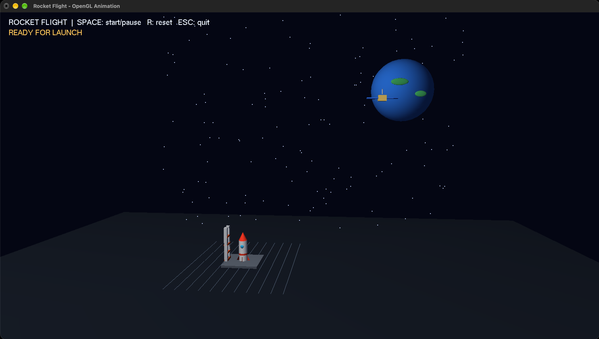
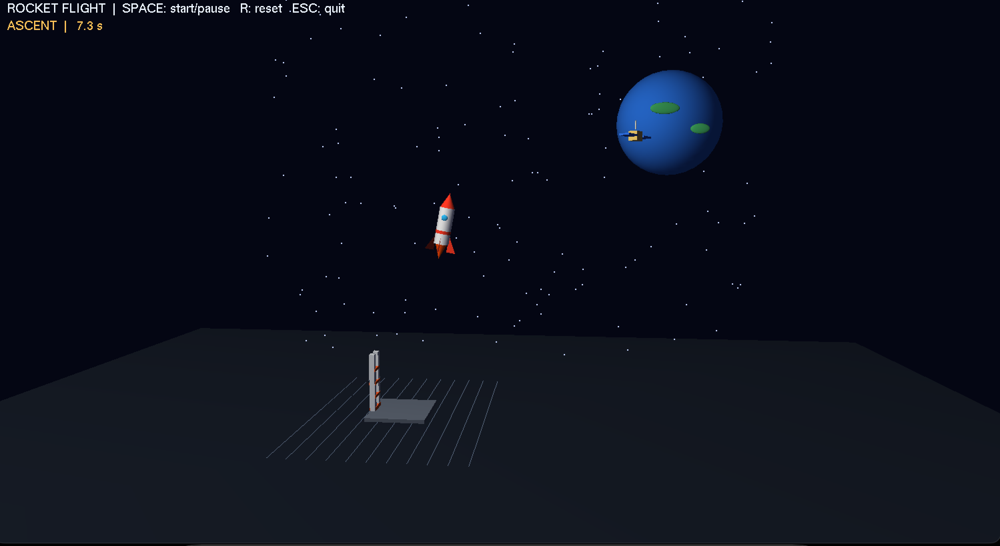
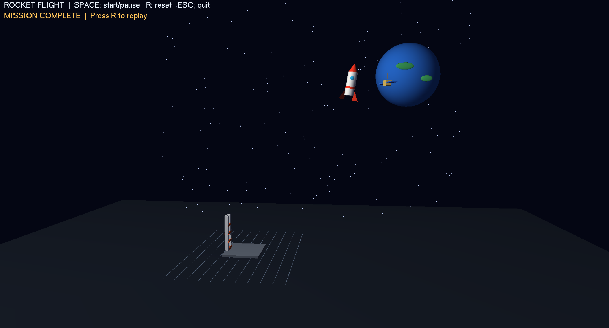

\newpage

## Abstract

This project investigates the main stages of producing a 3D animated movie and
demonstrates several of its computer-graphics principles in a small interactive
OpenGL application. The application presents a rocket waiting on a launch pad,
lifting off, ascending, and approaching a satellite. The rocket, launch
structure, satellite, and planet are modelled from geometric primitives. Its
motion is controlled by timed keyframes and smoothstep interpolation.

The project discusses model transformations, keyframe animation, lighting,
materials, camera positioning, and perspective projection. The C++ application
uses OpenGL with GLUT/GLU and includes keyboard controls to start, pause, and
reset the sequence. It was compiled successfully with CMake against the macOS
OpenGL and GLUT frameworks. Screenshots document the initial, ascent, and
completed stages, and a separate screen recording accompanies the report.

## 1. Introduction

Three-dimensional animation combines scene design, geometric modelling,
movement, lighting, camera setup, and image generation. In a production
pipeline, these activities are coordinated so that the audience can understand
the action and the rendered images communicate the intended story [1], [2].

The goal of this project is to demonstrate these ideas in a short, self-contained
OpenGL sequence. The scene tells a simple story: a rocket begins at a launch
pad, takes off, moves through the scene, and finishes near a satellite. The
application is intentionally small enough to explain and modify, while still
showing several core 3D graphics techniques.

### 1.1 Objectives

The project objectives are to:

1. Describe the typical stages involved in developing a 3D animated movie.
2. Explain geometric transformations, keyframes, and interpolation.
3. Discuss the roles of lighting, texturing, camera positioning, and projection.
4. Implement and demonstrate a short OpenGL animation containing at least three
   distinct 3D objects.
5. Provide interactive controls, source code, a working executable, and
   screenshots of the application.

## 2. Background Research

### 2.1 Stages in 3D animated-movie development

A production commonly begins with **pre-production**: defining the concept,
story, visual style, and sequence of events. A storyboard or shot plan helps
decide what the audience should see and when. The next stage is **asset
production**, in which objects and characters are modelled and prepared for use.
More complex characters may need a skeleton or rig so that their parts can be
posed consistently.

During **layout and animation**, assets are placed in scenes and their
transforms are animated. Key poses define important moments, while interpolation
creates the intermediate motion. The scene is then refined with **materials,
lighting, and camera work**. Rendering converts the scene description into
images; editing and compositing can combine or adjust rendered images, titles,
effects, and sound into a final movie [1], [2].

This project is a compact real-time demonstration rather than a full film
pipeline. Its story and timing act as pre-production; GLUT primitives form the
assets; the keyframe data defines the rocket's animation; and the OpenGL display
callback renders the scene from a fixed camera. It does not implement a
separate modelling/rigging package, offline render farm, editing, or
compositing.

### 2.2 Geometric transformations

Objects are authored in local coordinates and moved into the world using
transformations. With column vectors, translation, rotation about the
$z$-axis, and scaling can be written as:

$$
T =
\begin{bmatrix}
1&0&0&t_x\\
0&1&0&t_y\\
0&0&1&t_z\\
0&0&0&1
\end{bmatrix},\qquad
R_z(\theta) =
\begin{bmatrix}
\cos\theta&-\sin\theta&0&0\\
\sin\theta& \cos\theta&0&0\\
0&0&1&0\\
0&0&0&1
\end{bmatrix},
$$

$$
S =
\begin{bmatrix}
s_x&0&0&0\\
0&s_y&0&0\\
0&0&s_z&0\\
0&0&0&1
\end{bmatrix}.
$$

For a point $p$ in an object's local coordinate system, its world position is
$p_{\text{world}} = T R_z S p$. This order first scales the model, then rotates
it, and finally translates it. Transform order matters because matrix
multiplication is not commutative [1], [3].

The application uses OpenGL's matrix stack to isolate each object's
transformations. For example, the rocket is translated to its animated
position, rotated to its current tilt, and uniformly scaled. `glPushMatrix()`
and `glPopMatrix()` preserve and restore the surrounding transform so that the
rocket's movement does not move the launch pad or planet.

### 2.3 Keyframes and interpolation

A keyframe records an object's important state at a particular time. In this
application a rocket keyframe stores time, position, tilt angle, and scale.
For two consecutive keyframes at $t_i$ and $t_{i+1}$, the normalized
interval parameter is:

$$
u = \frac{t-t_i}{t_{i+1}-t_i}, \qquad 0 \leq u \leq 1.
$$

The program applies the smoothstep function

$$
s(u)=3u^2-2u^3
$$

and interpolates each position component $q$ as

$$
q(t) = (1-s(u))q_i+s(u)q_{i+1}.
$$

The same interpolation is applied to the rocket's tilt and scale. Smoothstep
has zero slope at both ends of an interval, producing eased starts and stops.
This is a simple form of keyframe animation: artists or programmers define the
important poses, and the computer calculates the in-between values [2].

The animation clock is based on elapsed GLUT time rather than on the number of
rendered frames. This makes the timing less dependent on the computer's frame
rate. A sinusoidal function also varies the engine flame's length while the
rocket is in flight.

### 2.4 Lighting, materials, texturing, and camera

Lighting helps reveal an object's shape and position. The application enables
one positional light and supplies ambient, diffuse, and specular lighting
values. Surface colours are assigned using OpenGL colour material. Normals
allow the lighting calculation to respond to surface orientation, while depth
testing determines which surfaces are in front [1], [3].

Texture mapping places image data on a surface and can add detail without
requiring every detail to be modelled geometrically. It is widely used for
surface patterns, labels, and fine visual detail. The current application does
**not** load image textures: it uses solid material colours and geometric
primitives instead. This keeps the implementation focused on transformations
and animation, while texturing is covered here as part of the research topic.

A camera defines the view of the 3D world. The program positions its camera with
`gluLookAt()` and uses `gluPerspective()` to create perspective projection, in
which distant objects appear smaller. The viewport aspect ratio is updated when
the window is resized. Near and far clipping distances limit the depth range
that is rendered [1], [3].

## 3. Application Design and Implementation

### 3.1 Tools and project files

The application is written in C++ and uses traditional OpenGL, GLU, and GLUT.
The assignment permits either traditional or modern OpenGL. The project files
are:

- `main.cpp` — scene construction, rendering, animation, and input handling.
- `CMakeLists.txt` — CMake configuration and graphics-library linking.
- `README.md` — build instructions and control summary.
- `report.md` — this report's editable source.
- `screenshots/` — application captures and the supplementary recording.

On macOS, the application can be built from the project directory with:

```sh
cmake -S . -B build
cmake --build build
./build/rocket_movie
```

The source also selects the standard GLUT/GLU include paths on non-Apple
platforms, subject to the relevant OpenGL and GLUT development libraries being
installed.

### 3.2 Scene objects

The scene contains more than the required three objects:

- **Rocket:** a cylindrical body, conical nose, fins, porthole, and animated
  engine flame.
- **Launch pad and tower:** cubes form the platform, supports, and crossbars.
- **Satellite:** a central body, two solar panels, and an antenna.
- **Planet:** a sphere with raised coloured regions.
- **Environment:** a ground plane, runway markings, and a generated star field.

The objects are assembled from GLUT and GLU primitives and simple triangles.
Their parts are placed using nested transformations. This approach demonstrates
how a complex-looking object can be constructed from simpler geometric
components.

### 3.3 Animation sequence

The sequence lasts 13.5 seconds. The rocket begins at rest on the launch pad,
then ascends and travels toward the satellite. Its position, tilt, and scale
are read from a series of timed keyframes and interpolated between them. The
satellite rotates slowly about the vertical axis. The flame appears during
flight and pulses in length.

| Approximate time | Sequence phase | Intended action |
|---|---|---|
| 0–2 s | Ready / systems check | Rocket waits on the pad |
| 2–5.2 s | Liftoff | Rocket rises from the pad |
| 5.2–8.8 s | Ascent | Rocket continues upward and begins to tilt |
| 8.8–11.5 s | Orbital approach | Rocket travels toward the satellite |
| 11.5–13.5 s | Mission complete | Rocket holds its ending pose |

The final phase and on-screen status text provide an explicit ending. The
animation can be replayed by resetting and starting it again.

### 3.4 Rendering and interaction

The GLUT display callback clears the colour and depth buffers, sets the camera,
positions the light, draws the scene objects, and overlays a 2D status display.
Double buffering reduces visible flicker. The reshape callback updates the
viewport and perspective projection. The idle callback advances the animation
clock while the sequence is running and requests a new frame.

Keyboard controls are:

- **Space** or **P** — start or pause the animation.
- **R** — return to the initial pose.
- **Esc** — close the application.

## 4. Results and Screenshots

The project was configured and compiled successfully with CMake on macOS,
linking against the system OpenGL and GLUT frameworks. The application was
captured at its initial state, during ascent, and at the end of the sequence.
The on-screen status text identifies each stage. A supplementary recording is
provided separately as `screenshots/rocket_recording.mov`.

{width=95%}

{width=95%}

{width=95%}

## 5. Discussion

The implementation meets the main functional requirements by presenting
multiple 3D objects, showing translation, rotation, and scaling, and providing
keyboard controls for a defined animated sequence. The separate model and
rendering functions make the scene easier to understand and modify. The
keyframe data and interpolation routine make the motion parameters explicit,
which supports explanation of the mathematical principles during a
demonstration.

The application is intentionally a stylized teaching example rather than a
physically accurate simulation or a full production-quality film. The objects
are built from basic primitives; image textures, skeletal character rigs,
particle-based smoke, moving camera shots, sound, and post-production
compositing are not implemented. The rocket follows designed keyframes rather
than a force-based flight model. Traditional fixed-function OpenGL is used
because it is permitted by the assignment and keeps the transformation,
lighting, and GLUT callback concepts visible in the source.

Possible extensions include textured surfaces, a camera that follows the
rocket, smoke particles, more detailed models, and an additional animated
character or object. These would add polish but are not necessary to explain
the current implementation.

## 6. Conclusion

This project connects the theory and practice of 3D animation. The report
describes the production stages and the mathematical basis of object
transformations and keyframe interpolation. The OpenGL application applies
those ideas to a short rocket-launch sequence with a launch structure,
satellite, planet, lighting, perspective camera, and interactive controls.

The screenshots and accompanying recording document the sequence.

## References

[1] J. F. Hughes, A. van Dam, M. McGuire, D. F. Sklar, J. D. Foley, S. K.
Feiner, and K. Akeley, *Computer Graphics: Principles and Practice*, 3rd ed.
Addison-Wesley Professional, 2013. ISBN 978-0-321-39952-6.

[2] R. Parent, *Computer Animation: Algorithms and Techniques*, 3rd ed. Morgan
Kaufmann, 2012. ISBN 978-0-12-415842-9.

[3] D. Hearn, M. P. Baker, and W. R. Carithers, *Computer Graphics with
OpenGL*, 4th ed. Pearson, 2011. ISBN 978-1-292-02425-7.

[4] M. J. Kilgard, *The OpenGL Utility Toolkit (GLUT) Programming Interface*,
API Version 3, Silicon Graphics, Inc. Available:
<https://opengl.org/resources/libraries/glut/spec3/spec3.html>.
