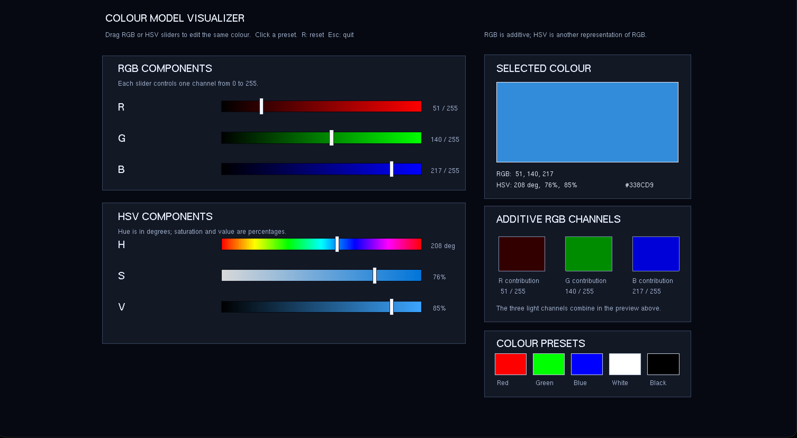

\newpage

## Abstract

This project investigates RGB, CMYK, and HSV colour models and demonstrates
interactive colour selection and conversion in a C++/OpenGL application. RGB is
an additive model used widely for electronic displays and digital images; CMYK
is a subtractive model used in printing; and HSV provides a hue-oriented
representation useful for interactive colour selection. The application lets
the user edit a shared colour with either RGB or HSV sliders, view the live
result and its numeric values, and observe the separate RGB channel
contributions.

The report presents the models' mathematical representations, practical uses,
advantages, and limitations. It describes the RGB-to-HSV and HSV-to-RGB
algorithms implemented in the application. The program uses OpenGL with
GLUT/GLU, and includes colour-conversion tests. A screenshot of the running
visualizer is included; a separate screen recording accompanies the project.

## 1. Introduction

A colour model describes colours using a set of numerical components. It gives
graphics software, imaging devices, displays, and printers a way to represent
and exchange colour values. Different models are designed for different tasks:
RGB represents additive display channels, CMYK describes print inks, and HSV
reorganizes RGB into components that are often easier for people to adjust [1],
[2].

This project compares these models and implements an interactive visualizer.
The application shows how changing a component changes a displayed colour and
how the same colour can be represented in both RGB and HSV. CMYK is covered in
the research and comparison; the application focuses on the RGB mixing and
RGB/HSV conversion features specified in the assignment.

### 1.1 Objectives

The objectives are to:

1. Explain what colour models are and why they are important in computer
   graphics and digital imaging.
2. Compare RGB, CMYK, and HSV, including their mathematical representations
   and common applications.
3. Discuss the benefits and limitations of each model for displays, digital
   imaging, and printing.
4. Implement an interactive OpenGL visualizer for RGB selection and mixing,
   RGB/HSV conversion, and component adjustment.
5. Test the conversion routines and document the application with a screenshot
   and demonstration recording.

## 2. Background Research

### 2.1 Colour models and colour representation

A colour model specifies coordinates for describing a colour. The coordinates
alone do not always identify an absolute physical colour: for RGB, the chosen
primaries, white point, and transfer function also matter. A defined RGB
colour space such as sRGB supplies these additional characteristics for
consistent encoding and communication [4].

Digital colour models are important because different devices create or
reproduce colour in different ways. A display emits light, while a printer
typically combines inks that absorb parts of the light reflected by paper.
Using a suitable model makes it easier to specify, process, edit, and output
colour, although colour-management transforms may be needed when moving
between devices or spaces [1], [3], [4].

### 2.2 RGB: additive colour

RGB represents a colour with red, green, and blue channel values:

$$
\mathbf{C}_{RGB} = (R,G,B), \qquad 0 \le R,G,B \le 1.
$$

An electronic display produces colours by combining red, green, and blue light.
In the idealized additive model, the three channel contributions are
independent: black is $(0,0,0)$, and full red, green, and blue are
$(1,0,0)$, $(0,1,0)$, and $(0,0,1)$. Combining two full primaries gives
cyan, magenta, or yellow; combining all three at full intensity gives white.
The visualizer shows the current contribution of each channel and the
combined result.

RGB is convenient for display hardware and digital image pixels, and it is
straightforward to store and manipulate as three values. Its limitations are
that it is device-dependent unless tied to a specific colour space, and its
coordinates are not perceptually uniform: equal numeric changes do not
necessarily look equally large. RGB also does not directly separate properties
such as hue from brightness [1], [4].

### 2.3 HSV: a hue-oriented representation

HSV describes colour using hue $H$, saturation $S$, and value $V$. Hue is
an angle around a colour wheel, saturation measures distance from a neutral
gray, and value represents the maximum RGB component. HSV is a transformation
of RGB rather than a different set of display primaries. It is useful in
interactive interfaces because a user can adjust hue separately from
saturation and value [1], [2].

HSV is not a perceptually uniform colour space and does not define a
device-independent colour by itself. Hue is undefined for achromatic colours
where all RGB components are equal; software commonly assigns a conventional
hue such as zero. Despite these limitations, HSV is useful for colour pickers
and simple colour-editing controls.

### 2.4 CMYK: subtractive colour

CMYK represents cyan, magenta, yellow, and black ink components. The cyan,
magenta, and yellow inks absorb light from the paper; black ink (K) is added
for deeper blacks, neutral detail, and practical ink control. CMYK is therefore
used primarily in printing rather than as a display's native colour model [1],
[3].

For an idealized conversion from normalized RGB to CMYK, a simple black
component can be calculated as:

$$
K = 1 - \max(R,G,B).
$$

If $K=1$, the colour is black and $C=M=Y=0$. Otherwise:

$$
C = \frac{1-R-K}{1-K}, \qquad
M = \frac{1-G-K}{1-K}, \qquad
Y = \frac{1-B-K}{1-K}.
$$

These equations illustrate the relationship between the models, but they are
not a complete print-production conversion. Real results depend on ink,
paper, press characteristics, black generation, and colour profiles. CMYK's
advantage is that it maps to print channels; its limitations include
device-dependent values and a printable gamut that may differ from or be
smaller than a display's gamut [3], [4].

### 2.5 Comparison of RGB, CMYK, and HSV

| Model | Representation and common use | Main advantages and limitations |
|---|---|---|
| RGB | Additive red, green, and blue channels; displays and digital image pixels. | Directly represents display channels and is simple to store. Values depend on the RGB colour space, and the coordinates are not perceptually uniform. |
| CMYK | Subtractive cyan, magenta, yellow, and black inks; printing. | Matches the print-ink workflow and includes a dedicated black channel. Values depend on the press, inks, paper, and colour profile. |
| HSV | Hue angle, saturation, and value derived from RGB; colour pickers and interactive editing. | Separates intuitive colour adjustments from the RGB channels. It is not device-independent or perceptually uniform, and hue is undefined for gray. |

The choice of model depends on the task: RGB is convenient for display and
pixel operations, CMYK is suited to ink output, and HSV can make manual colour
selection easier. Converting between a model and an actual device's output
still depends on colour-space definitions and colour management [1]–[5].

### 2.6 RGB and HSV conversion mathematics

The application stores RGB components as normalized floating-point values.
For RGB-to-HSV conversion, let:

$$
C_{\max} = \max(R,G,B), \qquad
C_{\min} = \min(R,G,B), \qquad
\Delta = C_{\max} - C_{\min}.
$$

Then:

$$
V = C_{\max}, \qquad
S =
\begin{cases}
0, & C_{\max}=0,\\
\Delta/C_{\max}, & C_{\max}>0.
\end{cases}
$$

Hue is calculated from the channel that equals $C_{\max}$:

$$
H =
\begin{cases}
0, & \Delta=0,\\
60^\circ \left(\left(\frac{G-B}{\Delta}\right)\bmod 6\right),
    & C_{\max}=R,\\
60^\circ \left(\frac{B-R}{\Delta}+2\right), & C_{\max}=G,\\
60^\circ \left(\frac{R-G}{\Delta}+4\right), & C_{\max}=B.
\end{cases}
$$

Negative hue values are wrapped into the range from 0° to 360°. The special
case $\Delta=0$ avoids division by zero and assigns zero hue to neutral
colours.

For HSV-to-RGB conversion, hue is first wrapped into one revolution, then:

$$
C = VS,\qquad
X = C\left(1-\left|\left(\left(\frac{H}{60^\circ}\right)\bmod 2\right)-1\right|\right),
\qquad
m=V-C.
$$

The pair $(C,X)$ is placed into the RGB channels according to which of the
six 60° hue sectors contains $H$; $m$ is then added to each channel. The
result is clamped to the valid RGB range. This sector-based procedure is
implemented directly in `color_math.h` [1], [2].

## 3. Application Design and Implementation

### 3.1 Project structure and tools

The visualizer is a C++ application using traditional OpenGL, GLU, and GLUT.
It uses a 2D interface because the assignment is about colour components rather
than three-dimensional geometry. The colour calculations are kept separate
from drawing code.

- `main.cpp` — OpenGL interface, sliders, swatches, input, and display.
- `color_math.h` — RGB/HSV structures and conversion routines.
- `color_math_tests.cpp` — tests for conversion and edge cases.
- `CMakeLists.txt` — application and test build configuration.
- `README.md` — controls and build instructions.
- `screenshots/` — the application screenshot and supplementary recording.

Build and run from the project root on macOS:

```sh
cmake -S colour_models -B colour_models/build
cmake --build colour_models/build
./colour_models/build/colour_visualizer
```

Run the conversion tests with:

```sh
ctest --test-dir colour_models/build --output-on-failure
```

### 3.2 Interface and colour data flow

The interface has RGB and HSV slider groups, a large selected-colour preview,
numeric RGB/HSV/HEX readouts, RGB channel-contribution swatches, and clickable
colour presets. The hue slider displays a spectrum; the saturation and value
sliders show gradients based on the current hue and value/saturation. Each
slider can be dragged with the mouse.

The application maintains an RGB value and its corresponding HSV value. When an
RGB slider changes, that channel is updated and `rgbToHsv()` recalculates the
HSV readout. When an HSV slider changes, the selected HSV component is updated
and `hsvToRgb()` recalculates the RGB value. Preset selection updates RGB and
then recalculates HSV. The preview and all numeric values update immediately.

The RGB inputs are stored from 0 to 1 and displayed as integer values from 0
to 255. The preview also displays an 8-bit hexadecimal value. In the supplied
screenshot, the selected value is RGB $(51,140,217)$, hexadecimal
`#338CD9`, which converts to approximately HSV $(208^\circ,76\%,85\%)$.

The three small channel swatches display $(R,0,0)$, $(0,G,0)$, and
$(0,0,B)$. Their additive combination is the larger selected-colour preview.
This makes the RGB mixing operation visible rather than presenting only the
final colour.

### 3.3 OpenGL drawing and interaction

The application draws the interface in an orthographic 2D coordinate system.
Panels and swatches are rendered as coloured quadrilaterals; gradient sliders
are built from small adjacent quads with changing OpenGL colours. GLUT bitmap
fonts display labels and numeric values. The reshape callback preserves the
interface aspect ratio, and mouse coordinates are mapped from the window into
the visualizer's logical canvas.

The mouse callback detects slider and preset clicks. While a slider is
selected, the motion callback converts the horizontal cursor position into a
normalized component value in the range $[0,1]$. The **R** key restores the
initial colour and **Esc** closes the application.

## 4. Results and Testing

The application compiled successfully with CMake against the system OpenGL and
GLUT frameworks. The CTest conversion suite passed. It checks primary and
secondary hues, black and gray edge cases, RGB/HSV round trips, and hue
wrapping. The screenshot shows both slider groups, the RGB contributions, the
selected colour, and the corresponding numeric values.

{width=95%}

The supplementary screen recording is supplied separately as
`screenshots/colour_recording.mov`.

## 5. Discussion

The implementation meets the application's main requirements: colours can be
selected with RGB components, RGB mixing is shown through separate channel
contributions and a combined preview, RGB/HSV conversions are implemented, and
components can be adjusted interactively. The conversion routines are separate
from the interface and are covered by automated tests.

The application demonstrates component relationships but is not a
colour-managed reference instrument. It uses normalized channel values and
OpenGL's default framebuffer; it does not apply an explicit sRGB transfer
function, ICC profile, or monitor calibration. Consequently, the numeric RGB
and HEX values are reproducible within the program, but the perceived physical
colour can vary with the display and viewing conditions [4], [5]. HSV is used
for convenient editing, not as a perceptually uniform measurement space.

CMYK conversion is discussed mathematically but is not part of the application.
A production print workflow would require a profile-aware conversion for the
specific printer, ink, and paper rather than relying on the simplified
equations alone [3].

## 6. Conclusion

This project explains why RGB, CMYK, and HSV are used in different parts of
computer graphics and digital imaging. RGB is suitable for additive display
mixing, CMYK corresponds to subtractive print inks, and HSV provides a
convenient way to select and adjust RGB colours. The OpenGL application makes
these relationships interactive and displays the conversion results. The
screenshot and separate recording document the working visualizer.

\newpage

## References

[1] D. Hearn, M. P. Baker, and W. R. Carithers, *Computer Graphics with
OpenGL*, 4th ed. Pearson, 2011. ISBN 978-1-292-02425-7.

[2] G. H. Joblove and D. Greenberg, “Color spaces for computer graphics,”
*ACM SIGGRAPH Computer Graphics*, vol. 12, no. 3, pp. 20–25, Aug. 1978.
doi: [10.1145/965139.807362](https://doi.org/10.1145/965139.807362).

[3] G. Sharma, Ed., *Digital Color Imaging Handbook*. CRC Press, 2003.
ISBN 0-8493-0900-X.

[4] International Electrotechnical Commission, *IEC 61966-2-1:1999:
Multimedia Systems and Equipment—Colour Measurement and Management—Part 2-1:
Colour Management—Default RGB Colour Space—sRGB*. Geneva: IEC, 1999.
Available: <https://webstore.iec.ch/en/publication/6169>.

[5] M. D. Fairchild, *Color Appearance Models*, 3rd ed. Wiley-IS&T, 2013.
ISBN 978-1-119-96703-3.
